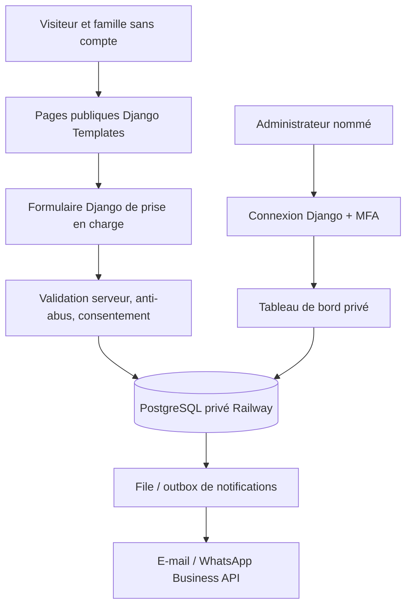

# NAKRE CARE — Audit et architecture cible Django / Railway

**Décision validée : 1 novembre 2026.** Document de conception, sans mise en production ni collecte nouvelle de données. Source : dépôt `ndongorenevaldez-design/nakre-care`, base auditée `main` au commit `ba669260`, puis branche documentaire `docs/audit-architecture-nakre-care` (commit `dde57ebf`).

## 1. Architecture finale retenue

**Un monolithe Django hébergé intégralement sur Railway.** Django rend les pages publiques avec Django Templates, gère les formulaires avec Django Forms, traite la logique métier et sert l'interface privée. Railway héberge :
- un service web Django (HTML, CSS, JavaScript, formulaires, API internes, tableau de bord et Django Admin) ;
- un service PostgreSQL privé, non exposé publiquement ;
- facultativement, un worker et une file de tâches pour les notifications fiables, si les besoins et le budget le justifient.

Le dépôt GitHub reste unique ; Codex Cloud est l'outil de développement. Ne pas introduire de SPA ou de framework frontend sans nécessité démontrée. Les composants HTML/CSS/JS et les éléments de marque existants sont conservés puis intégrés en templates et fichiers statiques Django.

**Architecture refusée comme cible finale :** vitrine Vercel + backend Railway, Vercel Functions, Supabase Auth/PostgreSQL. Elles ne doivent pas réapparaître dans le plan comme solutions retenues.

**Continuité :** Vercel reste l'hôte du site statique existant jusqu'à validation et mise en service du site Django complet sur Railway. Ne pas supprimer, désactiver ou modifier le déploiement Vercel durant les phases documentaires et de développement.

## 2. Audit de départ : constats conservés

| Zone | Constat réel sur `main` | Conséquence |
| --- | --- | --- |
| Code | Site statique : `index.html`, `recrutement/index.html`, `assets/styles.css`, `assets/site.js`, images et SEO. Pas de `manage.py` ni backend métier identifié. | Migrer progressivement, sans recréation graphique. |
| Vitrine | Présentation complète : services, approche, FAQ, contact, recrutement. | Garder contenus confirmés, URL utiles, CTA et métadonnées. |
| Formulaire de contact | Produit un texte WhatsApp côté JS. Sans JS, le formulaire HTML actuel peut envoyer des données en GET dans l'URL. | Corriger le repli GET ; ne jamais l'utiliser pour les renseignements patients. |
| WhatsApp | Numéro actuel `+237674134365` ; ouverture d'une conversation, pas enregistrement serveur. | Préserver le contact générique ; séparer le dossier confidentiel. |
| Recrutement mobile | Navigation à réexaminer, notamment les contrôles mobiles. | Mutualiser l'en-tête Django et tester le responsive. |
| Design | Tokens CSS et logo locaux, photographies WebP optimisées, palette officielle présente dans `assets`. | Réutiliser les assets sans réinventer l'identité. |
| Déploiement | Le site actuel est statique sur `https://nakre-care.vercel.app/`. Aucun projet Django/Railway versionné. | Tester Railway sur une URL distincte, sans toucher à la production. |
| Documentation récente | Quatre fichiers `docs/*.md` existent dans une branche documentaire ; aucune Pull Request signalée lors du contrôle. | Les harmoniser avec les décisions Django/Railway, sans perdre les constats d'audit. |

L'audit de la branche précédente est historique : ses recommandations Vercel Functions/Supabase sont désormais **supplantées** par ce document. Les réglages réels de Vercel, de Railway et d'un éventuel fournisseur de messagerie devront être contrôlés dans leurs tableaux de bord ; leur présence ne se déduit pas du code.

## 3. Architecture applicative

**Frontend et backend** fonctionnent dans la même application Django sur Railway. Les modèles de données, règles métier et autorisations sont contrôlés côté serveur, et non par JavaScript. Les templates servent les pages ; les fichiers CSS/JS officiels restent séparés. Prévoir `Gunicorn` (ou serveur WSGI/ASGI adapté), `WhiteNoise` ou équivalent éprouvé pour les fichiers statiques, `collectstatic`, gestion sûre des migrations et healthcheck.

### Apps suggérées

- `website` : accueil, présentation, services, FAQ, recrutement, contact générique WhatsApp ;
- `intake` : fiche publique, validation, accusé de réception ;
- `accounts` : invitation des administrateurs, rôles, sessions et MFA ;
- `patients` : dossiers actifs et contacts autorisés ;
- `interventions` : suivi et historique des prestations ;
- `notifications` : envois sans données de santé, traces et reprises ;
- `audit` : journal d'accès et modifications importantes, sans copie de notes sensibles.

Réutiliser le `User` Django ou créer un modèle utilisateur personnalisé **avant les premières migrations**, décision à documenter. Une inscription publique d'administrateur est interdite. Vérifier que l'obligation MFA couvre réellement toutes les vues et l'interface Django Admin (l'authentification native Django Admin ne suffit pas à appliquer automatiquement le MFA d'un package).

### Routes proposées sur une seule origine Railway

- `/`, `/recrutement/`, `/services/` si nécessaire : vitrine ;
- `/prise-en-charge/` : formulaire public inspiré de la fiche officielle ;
- `/prise-en-charge/confirmation/` : confirmation sans données médicales ni référence exploitable pour consulter le dossier ;
- `/confidentialite/` : informations et droits ;
- `/administration/` : portail privé personnalisé ;
- `/admin/` : Django Admin à accès restreint et MFA, ou autre chemin dédié après justification.

Ne jamais faire de `robots.txt`, du caractère « secret » d'une URL ou d'une vue masquée un mécanisme d'autorisation.

## 4. Modèle relationnel métier proposé

| Entité | Rôle |
| --- | --- |
| `CareRequest` | Demande anonyme au sens « sans compte », identifiants internes, informations strictement nécessaires et état. Ne signifie pas anonymat des données. |
| `ConsentRecord` | Notice versionnée, finalités, date, qualité du déclarant, accord(s) et vérifications nécessaires. |
| `PatientCase` | Dossier actif créé après acceptation, avec lien unique à la demande et responsable désigné. |
| `AuthorizedContact` | Proche dont les droits de communication ont été vérifiés ; distinct du simple contact déclaré. |
| `CarePlan` | Périmètre et fréquence de l'accompagnement. |
| `Intervention` | Date, intervenant, statut, résumé factuel et historique des corrections. |
| `AdminRole/Assignment` | Autorisation fondée sur les rôles et éventuellement sur l'affectation au dossier. |
| `AuditEvent` | Qui a accédé/modifié quoi et quand, sans stocker le contenu médical. |
| `NotificationOutbox` | Événement d'envoi minimal, tentatives, statuts et reprise d'erreur. |

Les coordonnées GPS sont facultatives, destinées uniquement à l'intervention et supprimables dès que devenues inutiles. Les transactions de création de dossier et de notification doivent être atomiques ou compensables ; empêcher les dossiers en double. Journaux et traces sans nom, diagnostic, adresse précise ni message libre.

## 5. Hébergement Railway et domaine sans achat

**Aucun domaine payant à acquérir pour démarrer.** Railway permet de générer un domaine de service `*.up.railway.app` dans **Settings → Networking → Public Networking → Generate Domain**. L'adresse précise est attribuée/configurée par Railway : ne pas écrire qu'un nom particulier serait déjà réservé. HTTPS géré par la plateforme. Il s'agit d'une adresse fournie sans frais d'achat de domaine, **pas d'un hébergement Django/PostgreSQL gratuit illimité**.

Séparer :
- service web Django public, relié au port `$PORT` Railway ;
- PostgreSQL accessible depuis Django par réseau privé / variable de connexion, pas de domaine public PostgreSQL ;
- environnements de développement/test avec données fictives, distincts de la production, sous réserve des quotas/coûts Railway ;
- secrets Railway dans les variables d'environnement, jamais dans Git ni dans les ressources publiques.

Paramétrer `DEBUG=False`, `ALLOWED_HOSTS` sur l'hôte Railway réellement attribué, `CSRF_TRUSTED_ORIGINS` correctement ciblé, gestion sûre du proxy HTTPS, cookies Secure/HttpOnly/SameSite, politique de sécurité, contrôle d'accès, sauvegardes et restauration. Ne pas ajouter de wildcard large par commodité. Prévoir vérification des requêtes proxifiées et des en-têtes de sécurité.

**Crédits Railway :** le domaine fourni ne coûte pas de nom de domaine, mais les ressources Django + PostgreSQL consomment du crédit. Au 1 novembre 2026, la documentation Railway indique un essai pouvant inclure jusqu'à 5 USD sur 30 jours et un plan Free avec 1 USD de crédit mensuel ; consulter les conditions et l'état du compte avant tout engagement. La production 24/7 n'est pas garantie par cette hypothèse budgétaire. Ne jamais annoncer une facture nulle certaine.

Références : https://docs.railway.com/networking/domains/working-with-domains ; https://docs.railway.com/pricing/plans ; https://docs.railway.com/pricing/free-trial ; https://docs.railway.com/networking/public-networking .

## 6. Rôle exact de Vercel et bascule

1. **Développement** : Vercel publie toujours le site statique existant ; travailler sur une branche Git séparée ; aucune donnée patient réelle dans les tests.
2. **Railway de test** : déployer Django complet avec URL générée `*.up.railway.app` ; vérifier responsive, fonctionnalités, permissions, légalité, restauration et disponibilité.
3. **Validation** : arbitrage technique, juridique et financier avant activation d'une collecte de données de santé.
4. **Mise en service Railway** : même origine Railway pour vitrine, fiche et administration ; effectuer les tests post-déploiement avec supervision et plan de retour arrière.
5. **Retrait Vercel** : seulement après accord explicite, stabilité validée et analyse des liens externes/référencement. L'URL `*.vercel.app` ne se transfère pas à Railway. Si le déploiement Vercel est supprimé, un lien vers l'ancien domaine peut cesser de fonctionner ; anticiper communication et éventuelles redirections tant qu'il reste actif.

Ne pas prétendre que Vercel devient un proxy permanent ni que la nouvelle URL Railway est connue avant génération. Ne pas modifier le projet Vercel ni supprimer son intégration GitHub lors de cette phase documentaire.

## 7. Sécurité et responsabilité

Railway héberge les services, **mais n'assume pas à lui seul la sécurité de l'application** : accès MFA, autorisations par dossier, durées de conservation, sauvegardes testées, journalisation, protection contre l'abus, conformité et procédures d'incident restent à réaliser. Les personnes accompagnées pouvant être vulnérables et les réponses inclure des données de santé, une validation juridique au regard de la loi camerounaise n° 2024/017 est requise avant ouverture publique du formulaire sensible. Vérifier région d'hébergement, transferts internationaux, sous-traitants (Railway, e-mail, WhatsApp, anti-spam) et conditions contractuelles.

Ne jamais envoyer d'informations de santé dans des liens WhatsApp, journaux, paramètres URL, e-mails de notification ou outils d'analyse tiers. L'envoi WhatsApp automatisé exige un mécanisme professionnel distinct d'un simple lien `wa.me`.

## 8. Décisions encore à valider

- Schéma exact de la fiche de renseignements à partir de l'image officielle fournie, champs minimisés et autorité du tiers déclarant ;
- package MFA, stratégie de récupération et périmètre des rôles ;
- hébergement/région légaux, conditions de traitement et limites budgétaires Railway ;
- source des notifications et conditions WhatsApp Business Platform ;
- domaine Railway effectivement généré et calendrier de retrait Vercel ;
- sauvegardes, rétention, continuité d'activité et validation de production.

**Cette révision modifie uniquement le cadrage ; aucun déploiement, création de base ou mise en service n'est autorisé.**
