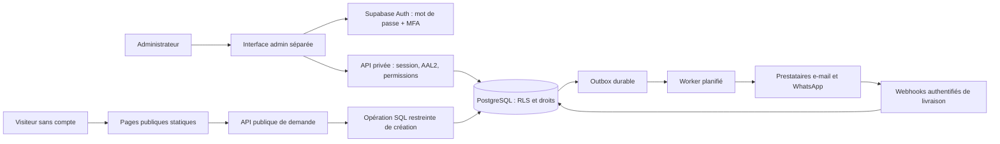

# Audit et architecture cible — NAKRE CARE

Date : 1 novembre 2026. Audit de `ba669260a8d21fc84c313f48d42fe58f8e159a8a`, identique à `main` distant lors du contrôle. Proposition soumise à validation ; aucune fonctionnalité, infrastructure distante ou collecte nouvelle n’est activée.

## 1. Conclusion

Conserver le site HTML/CSS/JavaScript, ses URL, textes utiles, médias et identité. Ajouter progressivement des fonctions serveur Vercel et Supabase PostgreSQL/Auth, sous réserve de validation de l’hébergement, de la sécurité et du cadre juridique. Aucun framework frontend n’est nécessaire pour ce volume et ces parcours. Les API ont besoin d’un runtime serveur et de dépendances limitées, verrouillées et maintenues ; cela ne justifie pas une reconstruction du site.

L’interface administrative peut rester en HTML/JS modulaire, avec ses propres fichiers. Sa visibilité et son URL ne constituent jamais une autorisation : chaque accès aux données exige une session, un MFA vérifié et une permission serveur/RLS. Reconsidérer un framework uniquement si la complexité mesurée des écrans le justifie dans une décision séparée.

## 2. Audit du dépôt

| Élément inspecté | Constat et conséquence |
| --- | --- |
| Structure | 23 fichiers suivis : deux pages, README, ancien AUDIT, robots, sitemap et 17 ressources dans assets. Aucun package.json, lockfile, backend, migration, test automatisé, CI ou AGENTS.md trouvé. |
| `index.html` | Vitrine complète : services, engagements, processus, FAQ, contact, recrutement. Un H1, langue française, description, canonical, Open Graph, JSON-LD Organization. Préserver ces acquis et les ancres. |
| `recrutement/index.html` | Parcours indépendant, canonical et description. CSS commun. Pas de script ni de menu mobile : la navigation principale et le CTA sont masqués sous 980 px, sans commande de remplacement ; les liens du pied restent accessibles. |
| `assets/site.js` | Une IIFE, aucune bibliothèque, aucune requête réseau métier ni stockage navigateur. Menu/Escape/redimensionnement, bouton flottant et formulaire vers WhatsApp. Valeurs interpolées dans une URL avec encodeURIComponent, pas de rendu HTML utilisateur observé. |
| Formulaire actuel | Nom, téléphone, besoin, texte libre obligatoires. `novalidate` avec checkValidity/reportValidity JS. Aucun maxlength, contrôle métier téléphone, consentement, référence persistante ou accusé de réception serveur. Téléphone `type=tel` accepte une chaîne quelconque. |
| Repli sans JS | Pas de method/action explicites : soumission HTML GET à l’URL courante, avec champs en query string et validation désactivée. Risque historique, logs et partage involontaire ; à corriger avant toute extension. |
| WhatsApp | Numéro cohérent +237674134365 ; liens wa.me, tel, candidature et bouton flottant. Le formulaire inclut nom/téléphone/besoin/situation dans `?text=`. Ce transfert externe peut contenir de la santé. Ouverture d’une fenêtre ≠ réception, envoi ou enregistrement d’une demande. |
| CSS | Variables de marque (#0b5d45/#073f31, accent #b95f39), grilles, breakpoints 980/760/380 px, adaptation paysage, safe-area et reduced-motion. Police système avec Inter en première préférence, aucun chargement de police distante. `overflow-x:clip` peut masquer un défaut : vérifier aussi les éléments, pas seulement la largeur globale. |
| Accessibilité | Skip links, labels, focus visible, tailles tactiles et aria-expanded présents. À compléter : retour du focus quand fermeture menu, accès clavier sans JS, erreurs par champ et synthèse liée aux champs, annonce des résultats asynchrones, audit contrastes/zoom/lecteur d’écran. Pas de certification WCAG issue de cet audit. |
| Bouton flottant | IntersectionObserver recalcule blockedBySection uniquement à partir des entrées modifiées du callback, pas de l’état mémorisé de toutes les sections. Risque de réapparition malgré une autre section toujours visible ; anomalie de logique à couvrir par test. |
| SEO | robots autorise tout ; sitemap contient accueil/recrutement. Garder canonical, métadonnées et contenus ; ajouter seulement les pages publiques nécessaires. Exclure admin/confirmation des index, sans considérer robots comme contrôle d’accès. |
| Déploiement | README annonce Vercel sans build et un dossier `nakre-care-site` absent du checkout (chemin réel `/workspace/nakre-care`). Aucun vercel.json, .vercel, réglage de build/root/runtime ni workflow versionné. Déploiement statique compatible en principe ; compatibilité des fonctions à vérifier dans le projet Vercel réel. |

### Médias et identité

Environ 9,1 Mio d’assets : trois grands PNG d’affiches de 2,6–2,7 Mio chacun, trois photographies WebP d’environ 59–72 Kio, logo SVG utilisé, variantes PNG/SVG et images sociales. Les affiches officielles et toutes les variantes doivent être conservées ; faire confirmer par le propriétaire le logo maître et les droits d’usage, sans remplacer les originaux. Le libellé « officielle » d’un fichier ne prouve pas les droits ou la version de référence.

`og-image.png` contient en réalité un JPEG, et `visuel-logo-cercle.png` aussi ; l’image sociale actuellement référencée est `og-nakre-care.jpg`, 1200×630. Aucun changement de format nécessaire dans cette PR. Les photos daily/team déclarent 900×1100 dans le HTML alors que leurs fichiers font 840×1050 ; prévoir correction des dimensions sans changer les visuels. Les ressources utilisées sont locales ; pas de tracker, formulaire tiers embarqué ou SDK trouvé. Les affiches volumineuses ne sont pas toutes chargées par les pages.

### Contrôles et limites

Contrôles locaux avec Python HTTP server et Chromium/Playwright, données fictives, aucune navigation WhatsApp réelle : voir le plan d’implémentation pour les résultats et réserves. `node --check assets/site.js` passe. L’ancien `AUDIT.md` décrit une refonte antérieure ; ses affirmations ne remplacent pas les observations de cette mission.

Lecture distante `git ls-remote origin refs/heads/main` réussie. Le site public et l’API GitHub ont répondu par un refus du proxy ; ni headers réels, TLS du site, configuration Vercel, quotas, logs, région, sauvegardes ni droits API ne sont donc établis. Aucun dashboard fournisseur accessible ni projet Supabase présent dans le dépôt. Ne pas déduire l’absence de protections en production de leur absence dans Git. Aucun secret applicatif identifié dans les fichiers suivis inspectés ; ce constat n’est pas un audit exhaustif de l’historique Git ou des fournisseurs.

## 3. Architecture recommandée

Séparer trois surfaces : vitrine existante ; `/demande/` et `/confidentialite/` ; `/admin/` avec scripts/styles propres et `/api/admin/*`. Le code de l’interface admin peut être téléchargé : il ne contient aucune donnée ni clé privilégiée. Les données restent inaccessibles sans autorisation. Préférer une session administrateur portée par cookies Secure/HttpOnly/SameSite et une protection CSRF explicite ; les fonctions Vercel gèrent création/renouvellement/révocation côté serveur. Ne jamais exposer refresh token ou clé service dans localStorage. Auth et autorisation à concevoir ensemble, y compris challenge MFA et récupération.

### API et frontières

| Route logique envisagée | Contrat minimal |
| --- | --- |
| POST `/api/demandes` | Seule écriture anonyme autorisée, JSON borné, anti-spam, quotas durables, idempotence, validation et consentement. Transaction demande + outbox ; réponse après commit avec référence non prédictible. Aucune lecture publique par référence. |
| `/api/admin/session/*` | Connexion, challenge MFA, renouvellement et déconnexion, sans mise en cache. Erreurs génériques, anti-bruteforce, inscriptions publiques désactivées. |
| `/api/admin/demandes/*` | Liste paginée/filtrée, détail et transitions autorisées, vérification JWT et état du compte à chaque opération. |
| POST `/api/admin/demandes/:id/accepter` | Conversion transactionnelle et idempotente en dossier, avec unicité request_id, contrôle de concurrence et audit. |
| `/api/admin/dossiers/*` | Contacts autorisés, affectations et événements chronologiques selon permission ; aucune lecture anonyme. |
| `/api/webhooks/*` | Signature, horodatage et anti-rejeu ; ne pas faire confiance à un statut fourni par le navigateur. |
| Worker planifié | Identité technique limitée, verrouillage des jobs, retries bornés, pas de données médicales dans payload/logs. |

Les routes exactes seront fixées lors de l’implémentation validée. Prévoir une fonction d’ingestion à rôle SQL dédié ou RPC strictement bornée ; pas de droit INSERT direct sur toutes les tables pour anon. La clé Supabase privilégiée reste serveur : elle contourne RLS et ne doit pas être utilisée pour toutes les requêtes admin. Les requêtes admin propagent l’identité de l’utilisateur ; les rares opérations privilégiées ont des vérifications et un audit explicites. Tests SQL par rôle obligatoires.

### Modèle relationnel proposé

| Entité | Fonction et restrictions |
| --- | --- |
| care_requests | Référence aléatoire, coordonnées demandeur/patient minimales, relation, besoin, disponibilité, lieu, coordonnées GPS facultatives, état et version. Données personnelles protégées. |
| consent_records | Version notice, finalités, horodatage et qualité du déclarant, distingués de la permission GPS et du consentement aux notifications. |
| patient_cases | Dossier issu d’une demande acceptée, responsable/affectations et état ; pas de dossier médical complet. |
| authorized_contacts | Identité/lien, périmètre d’échange, preuve de vérification, dates de validité et révocation ; distinct du simple demandeur. |
| service_events | Date effective, auteur, prestation, résultat factuel minimal ; corrections tracées, pas de réécriture silencieuse. |
| admin_memberships, case_assignments | Comptes Auth distincts, rôle attribué côté serveur, activation et périmètre ; jamais modifiables par self-service. |
| audit_events | Acteur, action, cible technique, résultat et date ; sans copie du contenu sensible. Écriture de confiance uniquement. |
| notification_outbox, notification_attempts | Message minimal, canal, destinataire autorisé, tentatives, statut fournisseur, prochaine tentative ; accès restreint. |

Contraintes FK, index sur dates/statuts/affectations, pagination et timestamps UTC ; afficher les horaires métier en Africa/Douala. Éviter JSON libre pour permissions et champs métier structurables. Ne pas faire du demandeur le contact autorisé par défaut. Définir les règles de doublons humains sans fusion automatique de personnes.

## 4. Compatibilité Vercel et changements minimaux

Après validation seulement : ajouter `api/`, dépendances serveur minimales avec lockfile, migrations Supabase et tests ; ajouter les trois surfaces HTML et scripts séparés, puis un lien discret depuis la vitrine. Réutiliser les tokens CSS et médias. Ne pas remplacer les routes existantes par une réécriture globale SPA. Vérifier root directory réel, framework preset statique, output, fonctions Node supportées, région et proximité DB, timeouts, cron, headers, quotas et séparation Preview/Production. Une Vercel Function n’est pas un worker permanent : utiliser une outbox et un ordonnanceur compatible avec le plan choisi.

Les previews doivent être protégées et branchées sur une base synthétique distincte, sans notifications externes. Attention : un simple push de branche peut déclencher une preview si l’intégration Vercel est active ; ne pas prétendre que la configuration actuelle l’empêche. La production reste soumise à validation explicite ; ne pas changer la branche de production ni fusionner automatiquement.

## 5. Coûts récurrents à budgéter

Estimations de cadrage en USD/mois, hors taxes et conversion XAF, au 1 novembre 2026 ; tarifs et éligibilité commerciale non vérifiés en ligne dans cette session. Ce ne sont pas des devis ni des tarifs fournisseurs certifiés.

| Poste | Hypothèse de budget | Déclencheur |
| --- | --- | --- |
| Vercel commercial | 20–60+ | Sièges, fonctions, trafic, protections et jobs selon plan ; vérifier conditions du plan gratuit pour activité commerciale. |
| Supabase production | 25–100+ | Compute, stockage, egress, sauvegardes/PITR, projets de test et niveau de service ; gratuit réservé à prototype synthétique si compatible. |
| E-mail transactionnel | 0–25+ | Volume, domaine d’envoi, délivrabilité, rétention et engagement. |
| WhatsApp Business Platform/BSP | Variable, provision initiale 10–100+ | Pays destinataire, catégorie et nombre de modèles, tarification Meta et majoration BSP ; numéro et compte business à qualifier. Un lien wa.me seul ne donne pas accès à une API d’envoi. |
| Anti-spam, quotas durables, supervision et sauvegarde externe | 0–75+ | Service choisi, volume, rétention, alertes et stockage hors base principale. |
| Domaine et messagerie professionnelle | Annuel / selon fournisseur | Domaine détenu, DNS, SPF/DKIM/DMARC et comptes métier. |

Ordre de grandeur initial : environ 80–360+ USD/mois, avant assistance, maintenance humaine, conseil juridique et dépassements. Exemple à 100 demandes/mois avec deux canaux : 200 jobs initiaux, plus retries et éventuelles relances ; chiffrer le nombre réel de destinataires et messages avant achat. Fixer budgets, alertes et limites fermes avant activation publique ; aucune souscription n’est effectuée par cette mission.

## 6. Décisions demandées

Valider le principe HTML/JS + API Vercel + PostgreSQL/Auth Supabase, puis les régions et contrats après avis juridique ; le périmètre des rôles ; le minimum de données ; le canal et fournisseur de notifications ; les budgets et objectifs de continuité. Si les transferts/hébergement envisagés ne peuvent être autorisés, garder la vitrine et réétudier l’hébergement du backend avant toute collecte. Voir [sécurité](SECURITE_ET_DONNEES.md), [cahier des charges](CAHIER_DES_CHARGES.md) et [plan](PLAN_IMPLEMENTATION.md).
