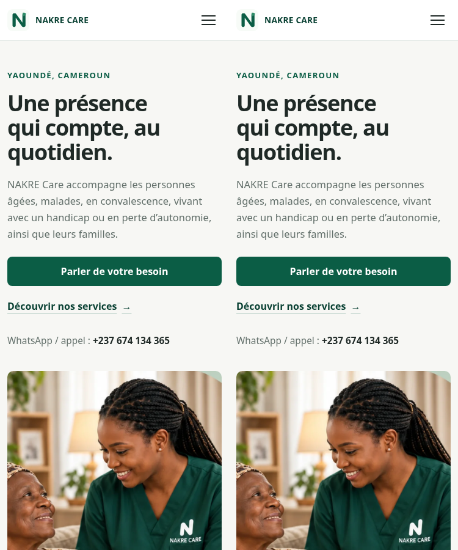
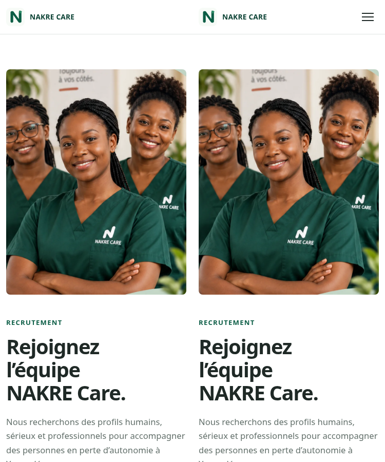

# Lot 1 — socle Django et migration de la vitrine

Base : `e7c7e60` (`docs/validation-django-railway-20261101`). Branche applicative : `feat/django-foundation-lot1`. Développement local uniquement ; aucune ressource Railway ni compte administrateur créé, aucune émission externe, aucun changement Vercel ou main.

## Ce qui fonctionne

Django 5.2 LTS, Python 3.12, PostgreSQL 17 local, Gunicorn/WhiteNoise et dépendances exactes dans `uv.lock`. Modèle User personnalisé dès la première migration, connexion par e-mail, mot de passe haché, unicité e-mail insensible à la casse garantie PostgreSQL. Les rôles natifs existent comme fondation ; permissions par dossier et parcours MFA restent aux lots autorisés ultérieurement.

Apps website/accounts/intake/patients/interventions/notifications/audit séparées. Seules website et la fondation User ont du code métier ; aucun modèle de patient, formulaire médical ou notification activé. Ni Django Admin ni routes de connexion ne sont montés, même pour un superutilisateur : le MFA n’est pas prétendu implémenté. La bibliothèque MFA sera intégrée et testée lorsque ce lot sera autorisé.

Accueil et recrutement migrés en templates communs. Assets d’origine utilisés directement par Staticfiles sous le namespace assets, sans copie ni modification de palette, logo ou photos. Originaux HTML/CSS/JS, robots et sitemap destinés à Vercel conservés octet pour octet. Le JS Django est séparé pour retirer toute soumission WhatsApp de renseignements et corriger l’état du bouton flottant ; recrutement bénéficie du menu mobile commun.

Le formulaire ancien est remplacé dans Django par un encart de contact générique sans champ. Aucun GET de formulaire, POST refusés ; aucun succès de collecte fictif. Les textes métier et médias sont conservés, seules les instructions liées à ce formulaire sont adaptées. Un ancien site Vercel peut toujours avoir son formulaire historique ; aucun correctif de production n’est revendiqué.

## Exécution locale reproductible

Prérequis : Python 3.12, uv, Docker Engine et Compose v2. Depuis la racine :

```sh
uv sync --frozen
python scripts/dev.py init
python scripts/dev.py up
python scripts/dev.py manage migrate --noinput
python scripts/dev.py manage check
python scripts/dev.py manage test --verbosity 2
python scripts/dev.py manage runserver 127.0.0.1:8000 --noreload
```

`init` crée une clé Django et un mot de passe de base locaux aléatoires dans `.local/development.env` (mode 0600, ignoré par Git), et préserve un fichier existant. Aucun utilisateur applicatif n’est créé. `up` attend PostgreSQL sain sur 127.0.0.1:55432 ; image PostgreSQL 17 épinglée par digest, volume nommé conservé. Le rôle PostgreSQL local a les droits nécessaires à la création d’une base de test : exclusivement pour développement, jamais à recopier en production. Ne pas utiliser de données réelles.

`python scripts/dev.py down` arrête les conteneurs et conserve le volume. Garder le fichier local de credentials avec ce volume. Ne pas le supprimer/régénérer en conservant le volume sans organiser la rotation du mot de passe. Les commandes utilisent `.venv` ; les variables de `.env.example` ne sont pas chargées automatiquement.

Dans Codex Cloud, les sockets et Docker peuvent nécessiter le mode d’exécution autorisé de la plateforme. Ne pas désactiver le proxy ou TLS pour installer les dépendances. Les dépendances validées sont conservées par le snapshot ; les processus doivent être relancés après restauration.

## Configuration future Railway (préparée, non déployée)

Utiliser `DJANGO_SETTINGS_MODULE=config.settings.production`, clé forte propre à l’environnement, `DATABASE_URL` privée et rôle applicatif à privilèges limités, `DJANGO_ALLOWED_HOSTS` exact et `PUBLIC_ORIGIN` HTTPS correspondante. Les valeurs absentes ou hôtes génériques bloquent le démarrage. `.env.example` liste les noms sans valeur sensible.

Build : `uv sync --frozen --no-dev`, puis `manage.py collectstatic --noinput` avec settings et variables appropriées. Migration contrôlée unique avant activation ; ne pas migrer au démarrage de chaque replica. Commande web envisagée : `.venv/bin/gunicorn config.wsgi:application --bind "0.0.0.0:$PORT"`. Aucune configuration d’autodéploiement ajoutée.

HTTPS, cookies Secure/HttpOnly/SameSite et CSRF disponibles. `TRUST_PROXY_HTTPS=1` uniquement après vérification que Railway remplace les en-têtes concernés. Les origines autorisées et la clé ne doivent jamais être inventées pour une production. HSTS limité à 3600 s, sans includeSubDomains ni preload avant qualification du domaine réel. Deux avertissements Django correspondants restent visibles ; un contrôle au niveau WARNING échoue donc intentionnellement à ce stade, sans être présenté comme une certification de déploiement.

WhiteNoise sert les statiques nommées par hash, le serveur Django ne sert pas les fichiers privés du dépôt. Par précaution de préproduction, robots interdit l’indexation et les templates portent noindex ; le retrait de ces protections et les canonical de bascule relèvent d’une validation future. Le domaine Railway réel reste à générer après autorisation. L’absence de coût d’achat de domaine n’implique pas un hébergement gratuit.

## Comparaison visuelle

Lancer le serveur statique original dans un second terminal :

```sh
python -m http.server 8001 --bind 127.0.0.1
.venv/bin/python tests/compare_render.py
```

Chromium doit être disponible à `/usr/bin/chromium` pour ce script (présent dans cet environnement). Le script produit captures complètes, comparaisons des premiers 900 px et résultats JSON dans `test-results/render/`, ignoré par Git. Il vérifie chargement des images, un H1, absence de débordement global, erreurs JS, menu mobile et navigation sans JS. Aucun lien WhatsApp n’est ouvert et aucun message n’est envoyé.

Résultats observés à 375 et 1440 px : premier écran accueil identique pixel par pixel ; recrutement desktop identique ; recrutement mobile diffère de 0,041 % des pixels du premier écran (menu ajouté). Inspection des montages mobile effectuée. Ces chiffres concernent le premier écran, pas la page entière : la zone contact change volontairement et le pied recrutement est mutualisé. Ce contrôle ne constitue pas une certification WCAG. Les dimensions historiques des images sont conservées dans ce lot pour limiter les différences ; les ajustements de ratio restent à examiner séparément.

Comparaisons mobiles conservées pour la revue (original à gauche, Django à droite) :





## Validation et limites

- Migration initiale et création de la base de test exécutées sur PostgreSQL ; pas de substitution SQLite.
- Suite Django : **9 tests réussis** ; e-mail, unicité DB, compte désactivé, routes privées absentes, refus POST/CSRF, absence de collecte, SEO et statiques couverts.
- `makemigrations --check --dry-run` : aucune migration manquante ; `check` : aucune erreur.
- `collectstatic` : 18 fichiers, 34 variantes post-traitées ; template production, CSS hashé WhiteNoise et redirection HTTPS vérifiés localement.
- `check --deploy` : aucun échec de niveau ERROR ; deux avertissements HSTS W005/W021 conservés et expliqués ci-dessus.
- Audit pip-audit des dépendances runtime verrouillées : aucune vulnérabilité connue signalée au contrôle (pas une garantie de sécurité exhaustive).
- Base locale après tests : zéro compte applicatif.
- Aucun test de MFA, de données patient, de sauvegarde métier ou de déploiement Railway revendiqué : hors Lot 1.

## Git et suite

L’API GitHub renvoie toujours `Forbidden` lors du contrôle de PR ; ne pas annoncer une PR créée. Le Lot 1 reste sur sa branche locale avec commits pour révision. Un push peut déclencher une preview Vercel selon l’intégration, dont les réglages ne sont pas visibles ici. Ne modifier aucun réglage Vercel sans autorisation.

Après rétablissement de l’API et vérification des automatismes de preview, les opérations restantes sont : publier `feat/django-foundation-lot1`, puis créer une **draft PR** vers `docs/validation-django-railway-20261101` pour isoler le diff du Lot 1. La base devra être revue si les PR documentaires sont fusionnées entre-temps. Commandes restantes, après vérification des automatismes :

```sh
git push -u origin feat/django-foundation-lot1
gh pr create --draft --repo ndongorenevaldez-design/nakre-care --base docs/validation-django-railway-20261101 --head feat/django-foundation-lot1 --title "Lot 1 : socle Django et migration de la vitrine" --body-file docs/LOT1_PR.md
```

Aucun merge automatique. Corps de PR proposé dans `docs/LOT1_PR.md`.

Arrêt après Lot 1 : attendre autorisation avant modèles patients, permissions métier/MFA fonctionnel, collecte, notifications ou provisionnement Railway.

### Mise à jour lors de la préparation du Lot 2

Le 1 novembre 2026, le commit local `e064ec1` a été vérifié avec arbre propre puis publié sur `origin/feat/django-foundation-lot1`. La tentative de draft PR a échoué (`Post https://api.github.com/graphql: Forbidden`). La branche distante préserve désormais le travail ; aucune PR ni fusion n’est revendiquée. Le paragraphe antérieur décrivant une branche seulement locale correspond à la clôture du Lot 1, avant cette publication.
