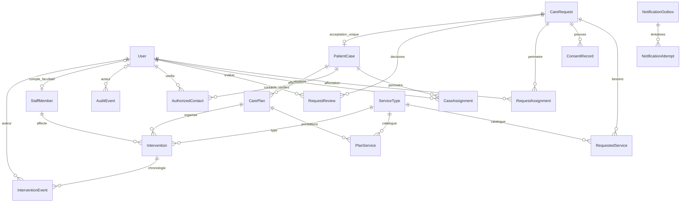

# Lot 2 — modèles PostgreSQL, intégrité et politiques d’accès

Réalisé le 1 novembre 2026, sur `feat/postgresql-domain-lot2`, créée directement depuis le commit Lot 1 `e064ec1`. Développement et tests locaux uniquement. Le rapport `LOT1_EXECUTION.md` est conservé. Aucun changement de main, des pages Vercel, des paramètres de production, des dépendances ou des routes publiques/privées.

## 1. Finalisation du Lot 1

Le commit `e064ec1` est présent, l’arbre de travail était propre avant création de la branche Lot 2. `git push -u origin feat/django-foundation-lot1` a réussi : le Lot 1 dispose désormais d’une branche distante. La tentative de draft PR avec `gh pr create --draft` a échoué : `Post "https://api.github.com/graphql": Forbidden`. Aucune PR Lot 1 créée par cette session, aucune fusion. Les comptes/réglages Vercel n’ont pas été modifiés ; un éventuel automatisme de preview GitHub/Vercel n’est pas observable via l’API bloquée.

Les deux avertissements HSTS du Lot 1 restent justifiés : en développement HTTP local, pas de redirection HTTPS/HSTS ; en production, HTTPS obligatoire, cookies sécurisés et HSTS 3600 secondes. `includeSubDomains` et `preload` attendent qualification du domaine réellement attribué, de ses sous-domaines et de la stratégie de bascule. Les avertissements W005/W021 ne sont ni masqués ni contournés ; la configuration production et ses protections n’ont pas été affaiblies dans ce lot. Ne pas annoncer une configuration Railway déjà validée.

## 2. Modèles implémentés

17 modèles métier, plus le User du Lot 1. UUID internes, timestamps UTC, dates métier Africa/Douala. La représentation textuelle des modèles contient uniquement le type et l’UUID, jamais nom, téléphone ou santé.

| Domaine | Modèles et fonctions |
| --- | --- |
| intake | `CareRequest` : demande, référence aléatoire indépendante de 128 bits, statut/version, coordonnées minimales, âge optionnel, lieu/GPS facultatifs et contexte borné. `ServiceType` et `RequestedService` : catalogue et association unique. `ConsentRecord` : notice, finalité, fondement et qualité du déclarant, sans base légale imposée par défaut. `RequestAssignment` : accès lecture/traitement par demande. `RequestReview` : évaluation interne et transitions. |
| patients | `PatientCase` : dossier unique par demande. `CaseAssignment` : périmètre et droit de gestion. `AuthorizedContact` : vérification explicite, scope, validité et révocation. `CarePlan` et `PlanService` : versionnement et prestations du plan. |
| interventions | `StaffMember` : intervenant indépendant d’un compte de connexion. `Intervention` : plan, prestation, intervenant, horaires prévus/réels et état/version. `InterventionEvent` : chronologie, transitions et corrections. |
| audit | `AuditEvent` : acteur, action, type/UUID cible, date et résultat, sans corps de formulaire ni notes. |
| notifications | `NotificationOutbox` : événement technique, canal, alias de destination, état et déduplication. `NotificationAttempt` : tentatives futures, codes techniques bornés. Aucun transport ou consommateur activé. |

Le catalogue initial contient seulement les trois prestations déjà confirmées dans la vitrine : domicile, milieu hospitalier, rendez-vous/déplacements utiles. La migration ne crée aucun compte ni patient. Les cases supplémentaires de la fiche papier (médicaments, sexe, hygiène, gardes, etc.) ne deviennent pas automatiquement des champs ou services publics. Le contexte est limité à 1000 caractères ; aucun champ diagnostic, ordonnance ou téléversement n’est créé. Le schéma reste un socle interne, pas une autorisation de collecte réelle.

`AdminRole` est représenté par les groupes et permissions Django, sans table de rôles concurrente. Aucun groupe métier ou compte permanent n’est préconfiguré : le provisionnement et les profils précis seront traités avec le Lot 3. `SubmissionToken` et le parcours d’ingestion anonyme restent à réaliser avec le formulaire public et son anti-abus, hors Lot 2.

## 3. Diagramme relationnel



Les liens d’`AuditEvent.target_id` et `NotificationOutbox.target_id` sont des références techniques UUID sans FK vers les données patient : éviter qu’une preuve minimale force une conservation illimitée d’un dossier. Leur cohérence est assurée par les services transactionnels et le périmètre des sélecteurs ; l’ORM direct reste un outil de backend de confiance. Les événements outbox actuellement émis ciblent exclusivement des demandes. Un nouveau type cible nécessitera une politique de lecture explicite.

## 4. Migrations et contraintes

Huit nouvelles migrations versionnées : initiales pour intake/patients/interventions/audit/notifications ; catalogue confirmé `intake.0002` ; protection des historiques `audit.0002` ; cohérence acceptation/dossier `patients.0002`.

- Unicité référence demande, code prestation, demande/prestation, demande/dossier, demande/administrateur, affectation active dossier/administrateur, dossier/version de plan, plan/prestation, clé outbox et numéro de tentative par job.
- Au plus un plan actif par dossier, version de plan positive, statuts bornés, âge 0–120, coordonnées GPS présentes ensemble et dans les plages valides, fin du plan après son début, validité du contact après vérification, fin d’intervention prévue après début, dates réelles cohérentes et obligatoires pour « effectuée », date de clôture cohérente.
- Index sur état/date des demandes et dossiers, affectations utilisateur/actif, plan/date et intervenant/date des prestations, outbox état/date et audit cible/date.
- Triggers PostgreSQL de contrainte **différés jusqu’au commit** : une demande acceptée doit avoir son dossier, et un dossier doit appartenir à une demande acceptée. L’acceptation et la création peuvent se faire dans la même transaction, mais un état incohérent ne peut pas être commité. Source du dossier non réaffectable.
- Triggers BEFORE UPDATE/DELETE sur audit, consentements, évaluations, événements d’intervention et tentatives : historiques append-only, y compris via QuerySet SQL. Les modèles refusent aussi la modification/suppression individuelle en Python. Un administrateur de base peut toutefois altérer les triggers : ce dispositif n’est pas une garantie d’inaltérabilité face au propriétaire PostgreSQL.
- Relations métier, acteurs et preuves en PROTECT. CASCADE seulement pour associations demande/prestation ou plan/prestation, si la suppression du parent est par ailleurs autorisée. Une demande interne sans dépendance protégée peut être supprimée ; une demande reçue avec consentement/historique ne peut pas être supprimée ordinairement.

La purge, les durées, l’anonymisation et le traitement des backups nécessiteront une procédure privilégiée et juridiquement validée ; aucune action de purge publique ou administrative n’est exposée. La protection des historiques ne doit pas être interprétée comme une conservation légale illimitée. Les migrations SQL ont des reverse SQL et le cycle retour au socle Lot 1 puis remontée a été testé **sur base synthétique** ; ne pas exécuter ce rollback destructif sur une base contenant des dossiers.

## 5. Services métier

| Module | Opérations et invariants |
| --- | --- |
| `intake.services` | `create_request` réservé aux acteurs internes autorisés, whitelist explicite, validation, consentement et outbox dans une transaction ; aucun HTTP anonyme. `assign_request` avec capacité dédiée. `transition_request` contrôle état/version. `accept_request` conversion atomique et idempotente. |
| `patients.services` | `assign_case`, `transition_case`, `authorize_contact`, `revoke_contact`, `replace_plan`. Pas de contact autorisé copié depuis le déclarant. Vérification explicite par l’acteur habilité ; le logiciel ne prouve pas à lui seul la qualité juridique d’un proche. |
| `interventions.services` | `schedule` contrôle plan actif, période, type de service et disponibilités de l’intervenant. `transition` exige les dates réelles pour une prestation effectuée ; `correct_note` ajoute un événement au lieu de réécrire une note précédente. |
| `common.services` | Validation, conflit de version, lecture verrouillée, journal minimal et outbox bloquée ; aucun appel externe. |

Demande : `new → review/cancelled`, `review → refused/cancelled` ; `review → accepted` uniquement via `accept_request`. Les états terminaux ne se rouvrent pas dans ce lot. Dossier : actif/suspendu, puis clôture terminale. Suspendre/clore exige de terminer ou annuler les prestations prévues. Intervention : prévue → effectuée/annulée, sans retour silencieux à « prévue ». Un nouveau plan remplace l’actif en conservant les anciennes versions et interventions associées.

Transactions PostgreSQL et verrous `select_for_update` : acteur, parent métier, puis intervenant/objet enfant dans un ordre cohérent. Les opérations d’un même acteur sont sérialisées ; choix conservateur adapté au démarrage, à mesurer si le volume augmente. Les versions attendues empêchent l’écrasement d’une écriture récente. Les conversions répétées autorisées retournent le dossier existant ; elles ne dupliquent ni audit d’acceptation ni outbox. En concurrence, le verrou de demande et la contrainte OneToOne se complètent.

L’accepteur obtient une **affectation explicite au dossier créé**, pas un accès global. Les autres affectations de demande ne sont pas transférées automatiquement en droits sur le dossier. Un second acteur doit avoir le droit de lecture du dossier pour récupérer le résultat d’une acceptation déjà effectuée. Les notes internes sont bornées et restent hors journal générique/notifications.

## 6. Autorisation réutilisable

`apps/accounts/policies.py` recharge l’acteur et ses droits depuis la base, sans réutiliser un cache de permissions d’un ancien objet Python. Compte authentifié, actif et staff requis ; superadministrateur actif ou permission globale **et** affectation autorisée. La modification requiert aussi `can_process` ou `can_manage`. Les groupes Django sont pris en charge par le backend standard et leur révocation est testée.

Sélecteurs réutilisables : `visible_requests`, `visible_cases`, `get_request`, `get_case`, `visible_reviews`, `visible_contacts`, `usable_contacts`, `visible_plans`, `visible_interventions`, `visible_intervention_events`, `visible_notifications`. Les contacts utilisables excluent ceux révoqués/expirés ; le périmètre textuel de leur autorisation reste à respecter. Le journal global est réservé au superadministrateur via `visible_audit_events` dans ce lot.

La capacité `triage_unassigned` autorise seulement la file de demandes sans affectation active. Assigner des droits exige une capacité spécifique et le droit de gestion de l’objet ; un administrateur non superutilisateur ne peut pas s’affecter lui-même des droits supplémentaires. Des permissions globales seules ne donnent pas accès à tous les dossiers. Aucune lecture par référence publique n’est définie ; un identifiant UUID interne seul ne contourne pas la politique.

**Limite de sécurité importante :** ces fonctions vérifient les droits métier, pas encore le MFA de session. Le Lot 3 doit ajouter cette exigence aux vues et à Django Admin. Les URLs privées/login/intake restent absentes dans ce lot, même pour un superutilisateur. Une future vue ou ModelAdmin doit utiliser les services/politiques pour listes, objets, choix de FK, actions groupées et exports ; enregistrer simplement les modèles dans un ModelAdmin par défaut contournerait les périmètres. L’ORM direct et les credentials DB restent des accès de confiance ; aucune RLS PostgreSQL n’est prétendue déployée.

Les lectures ne sont pas encore journalisées comme accès utilisateur : il n’existe aucun parcours privé HTTP. Le journal de ce lot trace les mutations importantes réussies, atomiquement avec celles-ci. Journalisation des accès, refus, login/MFA et procédures d’incident à compléter au Lot 3.

## 7. Notifications strictement inactives

La réception interne et l’acceptation produisent deux jobs techniques (e-mail, WhatsApp) à l’état **blocked**, destinataire logique `administration`. Aucun destinataire réel, corps médical, SDK, worker ou envoi. Une clé unique empêche les doublons ; aucun job marqué livré ou envoyé par les services du Lot 2. `NotificationAttempt` prépare le suivi futur, sans créer de tentative fictive comme une livraison réelle.

## 8. Tests exécutés et résultats

Commandes depuis la racine, avec les prérequis du Lot 1 :

```sh
python scripts/dev.py up
python scripts/dev.py manage migrate --noinput
python scripts/dev.py manage test --verbosity 2
python scripts/dev.py manage makemigrations --check --dry-run
python scripts/dev.py manage migrate --check
```

PostgreSQL réel dans Docker local, image épinglée du Lot 1 ; aucun SQLite. Suite finale : **35 tests réussis**, dont les **9 tests du Lot 1** inchangés et **26 tests Lot 2**. Données synthétiques uniquement. La base de test est détruite après exécution.

Couverture : création validée et rejet de champs internes injectés ; consentement/notifications transactionnels ; contraintes SQL d’unicité et plages ; suppressions permises/PROTECT ; acceptation depuis l’état requis ; idempotence ; rollback complet après échec tardif ; transitions interdites et versions périmées ; cohérence différée demande/dossier ; mutations d’historique refusées même par QuerySet ; consentements/contacts distincts ; révocation/expiration ; plans versionnés ; interventions et correction historisée ; droits globaux + affectations, lecture seule, file non affectée et interdiction d’auto-escalade ; révocation de groupe et désactivation malgré ancien objet Python ; absence de lecture publique par référence ; migrations aller/retour et présence effective des triggers.

Trois tests utilisent deux connexions PostgreSQL concurrentes et une barrière de synchronisation :

1. Acceptations simultanées : même UUID de dossier, un seul dossier, une seule évaluation d’acceptation et deux jobs bloqués uniques (un par canal).
2. Transitions simultanées avec même version : une réussit, l’autre reçoit un conflit, sans écrasement.
3. Réservation simultanée d’un intervenant sur deux dossiers : une planification réussit, l’autre reçoit un conflit de disponibilité.

Les contraintes d’intersection de planning reposent sur le service et le verrou de l’intervenant ; elles ne sont pas une contrainte EXCLUDE SQL contre tout accès ORM arbitraire. Les futures interfaces doivent passer par ce service. Les tests de migration sont destructifs uniquement dans la base de test ; ils ne valident pas encore une migration de production volumineuse ou une sauvegarde/restauration.

`check` : aucune erreur. `makemigrations --check --dry-run` : aucune migration manquante. `migrate --check` : base locale à jour. Après tests, la base de développement contient **0 compte applicatif, 0 demande**, uniquement les **3 prestations de catalogue**. Aucune donnée de test persistante dans la base locale.

## 9. Risques, limites et décisions ouvertes

- MFA, invitations, sessions vérifiées et interface privée : Lot 3, sur autorisation. Les droits métier seuls ne remplacent pas le MFA.
- Choix définitifs des champs de la fiche, santé, représentation du proche, services additionnels et validations juridiques : avant collecte publique. Ni ces modèles ni une preuve de consentement ne démontrent la conformité.
- Politique de réouverture de dossiers, purge, conservation/effacement et règles de contacts : à valider ; aucun outil contournant les historiques n’est fourni.
- Catalogue initial non médical limité aux services confirmés ; pas de diagnostic, traitement ou dossier médical complet. Les coordonnées/GPS restent protégés comme données personnelles même sans diagnostic.
- Les futures modifications de rôles doivent respecter les règles de synchronisation et la révocation ; pas de gestionnaire de comptes ou de rôle admin créé ici. Le rôle PostgreSQL de tests a des privilèges élevés ; un rôle runtime de production limité reste à provisionner et vérifier ultérieurement.
- Publication Git/PR et contrôles distants limités par le refus API ; aucune affirmation sur des checks CI, revue GitHub ou déploiement externe.
- HSTS/proxy/domaine, exploitation Railway, sauvegardes et budget inchangés et non validés par ces tests locaux.

## 10. Publication et arrêt au Lot 2

Les branches restent distinctes. La draft PR Lot 1 doit cibler la branche documentaire validée ; la draft PR Lot 2 doit cibler `feat/django-foundation-lot1` pour isoler le diff. Réexaminer les bases si les travaux précédents sont fusionnés ultérieurement. Commandes préparées :

```sh
gh pr create --draft --repo ndongorenevaldez-design/nakre-care --base docs/validation-django-railway-20261101 --head feat/django-foundation-lot1 --title "Lot 1 : socle Django et migration de la vitrine" --body-file docs/LOT1_PR.md
git push -u origin feat/postgresql-domain-lot2
gh pr create --draft --repo ndongorenevaldez-design/nakre-care --base feat/django-foundation-lot1 --head feat/postgresql-domain-lot2 --title "Lot 2 : modèles PostgreSQL, intégrité et politiques d’accès" --body-file docs/LOT2_PR.md
```

La disponibilité distante et les résultats de publication sont rapportés dans le bilan de session ; aucune PR ne doit être annoncée sans URL confirmée. Aucun merge automatique. Demander l’autorisation du propriétaire avant le Lot 3 ; aucun provisionnement Railway ni nouvelle dépense.
